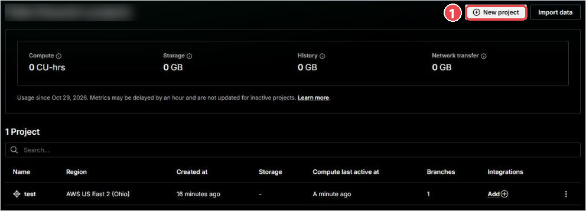
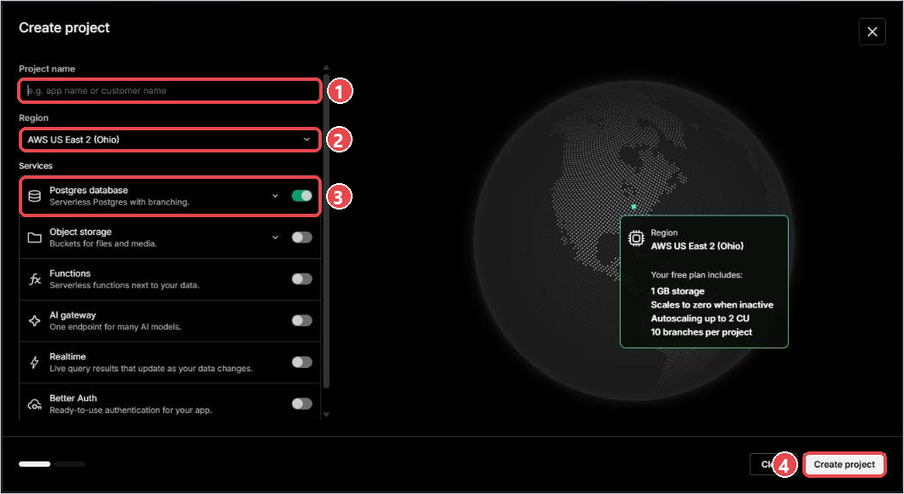
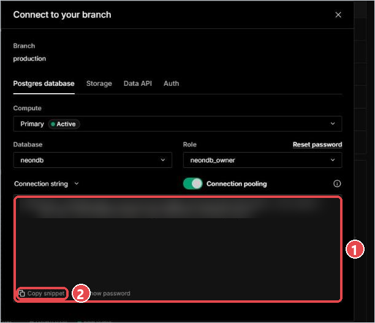
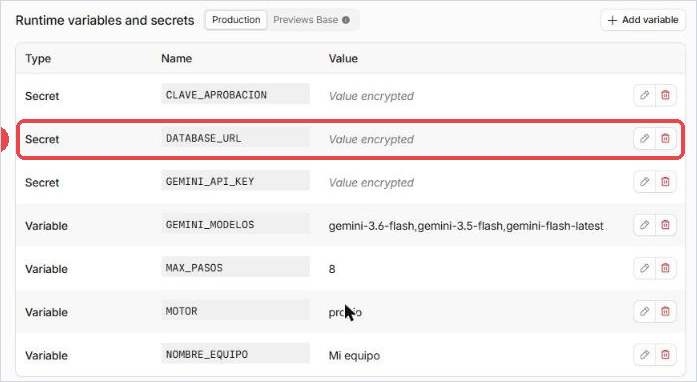
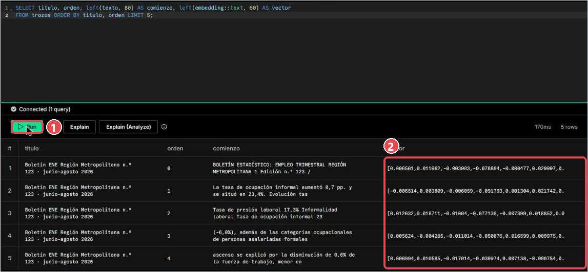
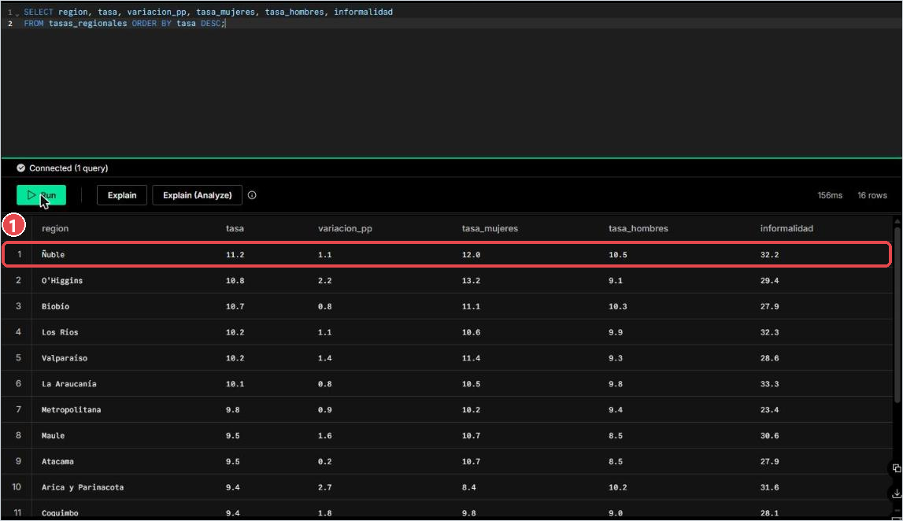
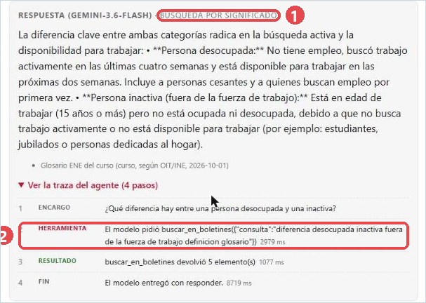
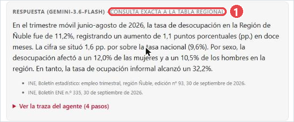
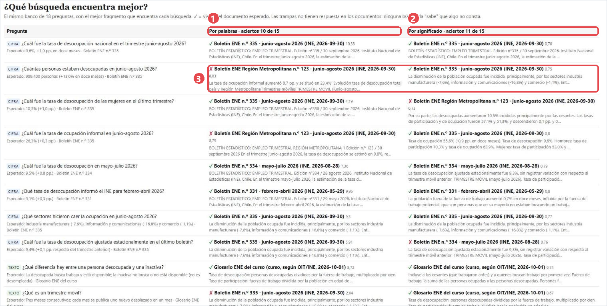

# Paso a paso, clase 8: tu propia base de datos para el agente

Hoy tu agente aprende a **buscar por significado**. Hasta ahora, para responder una pregunta contaba qué
palabras de la pregunta aparecían en cada fragmento de los boletines. Desde hoy, convierte la pregunta y cada
fragmento en vectores (listas de 768 números que representan el significado) y busca los más parecidos. Esos
vectores viven en una base de datos tuya, gratis, en **Neon**.

Capturas reales del ensayo del 28-10-2026. Los números rojos de cada captura corresponden a los del texto. Lo
marcado con ⚠ no se pudo ver en pantalla (necesita un fork de otra cuenta).

| Paso | Qué haces | Tiempo |
|---|---|---|
| 1 | Sync fork: traer lo nuevo del curso | 1 min |
| 2 | Neon: crear el proyecto y copiar la cadena de conexión | 3 min |
| 3 | Cloudflare: guardar `DATABASE_URL` como secreto | 2 min |
| 4 | Indexar: llenar la base de datos | 1 min |
| 5 | Mirar la base de datos por dentro (SQL Editor) | 3 min |
| 6 | Preguntar: una de texto y una de región | 2 min |
| 7 | Comparar las dos búsquedas (`/evaluar`) | 5 min |
| 8 | Activar el cron por commit | 2 min |
| 9 | El boletín 336: que tu agente lo descubra | 2 min |

**No fuercen corridas antes del paso 9**: el INE publicó el boletín 336 el jueves y queremos que su agente lo
encuentre en clase.

---

## 1. Sync fork

1. Abre tu fork: `github.com/<tu-usuario>/ia-toolkit`.
2. Encima de la lista de archivos aparece "This branch is … commits behind sil7en/ia-toolkit:main". Aprieta
   **Sync fork** → **Update branch**. ⚠
3. Punto de control: el mensaje cambia a "This branch is up to date with sil7en/ia-toolkit:main" (si hiciste
   cambios propios, dice además cuántos commits "ahead": son los tuyos, y se conservan).

Qué llega: la búsqueda por significado, la tabla de cifras regionales, las rutas `/indexar`, `/evaluar`,
`/regiones` y `/exportar.csv`, y la herramienta `tasa_por_region`. **Tus cambios se conservan**: tu regla en
`objetivo.md`, tu marca, tus colores y la herramienta que hiciste con Jules. Cloudflare y Vercel vuelven a
desplegar solos (1 minuto).

> Si GitHub dice **"This branch has conflicts"**, no descartes nada: avisa al profesor.

---

## 2. Neon: crear tu base de datos

1. Entra a **console.neon.tech** con tu cuenta (la que creaste con **Continue with GitHub**).
2. Aprieta **New project** ①.



3. En **Create project**: escribe `ia-toolkit` en **Project name** ①; deja la **Region** que viene ② (AWS US
   East 2, Ohio, funciona bien desde Chile); deja **Postgres database** activado ③ (los demás servicios,
   apagados) y aprieta **Create project** ④.



4. En el panel del proyecto, aprieta **Connect** (botón verde, arriba a la izquierda). Se abre **Connect to your
   branch**: la **Connection string** ① empieza con `postgresql://` y la contraseña aparece con asteriscos.
   Aprieta **Copy snippet** ②: copia la cadena completa, con la contraseña real.



Esa cadena es una **clave**: no la pegues en GitHub, en un issue ni en el chat.

---

## 3. Cloudflare: el secreto `DATABASE_URL`

Igual que `GEMINI_API_KEY` en la clase 7:

1. Cloudflare → tu Worker `ia-toolkit` → **Settings** → **Runtime variables and secrets** → **Add variable**.
2. **Key** `DATABASE_URL` · **Value** la cadena de Neon · marca **Secret** → **Add variable and deploy**.
   Queda una fila más ①, de tipo **Secret**, que dice *Value encrypted*.



3. Punto de control: abre `https://ia-toolkit.<tu-subdominio>.workers.dev/`. Debe decir `"rag": "local"`,
   `"trozos": 0` y la nota *"Neon conectado pero vacío: abre /indexar…"*. Conectado, pero todavía vacío.

---

## 4. Indexar: llenar la base de datos

Abre en el navegador (con tu clave de aprobación, la misma con que apruebas borradores):

```
https://ia-toolkit.<tu-subdominio>.workers.dev/indexar?clave=<tu clave de aprobación>
```

Qué hace, en orden: crea las dos tablas, corta cada boletín en trozos de ~700 caracteres, le pide a Gemini el
vector de cada trozo, guarda trozo + vector en Neon, y carga las cifras de las 16 regiones. La respuesta:

Respuesta real del ensayo (9,6 segundos):

```json
{ "ok": true,
  "documentos": [
    { "documento": "B335", "titulo": "Boletín ENE n.º 335 · junio-agosto 2026", "trozos": 4 },
    { "documento": "B334", "titulo": "Boletín ENE n.º 334 · mayo-julio 2026", "trozos": 18 },
    { "documento": "B331", "titulo": "Boletín ENE n.º 331 · febrero-abril 2026", "trozos": 10 },
    { "documento": "GLOS", "titulo": "Glosario ENE del curso", "trozos": 4 },
    { "documento": "RM123", "titulo": "Boletín ENE Región Metropolitana n.º 123 · junio-agosto 2026", "trozos": 7 } ],
  "trozos": 43, "vectores": 43, "regiones": 16, "trimestreRegional": "junio-agosto 2026",
  "via": "vector", "avisos": [], "segundos": 9.6 }
```

Punto de control: vuelve a abrir `/`. Ahora dice `"rag": "vector"` y cuántos trozos y regiones tiene.

Si lo abres dos veces no se duplica nada: cada documento se borra y se vuelve a guardar.

---

## 5. Mirar la base de datos por dentro

En Neon → menú izquierdo **Postgres database → SQL Editor**. El editor trae un ejemplo que **crea una tabla**
(`playing_with_neon`): **bórralo entero** (Ctrl+A, Supr) antes de pegar. Pega y aprieta **Run** ①:

```sql
SELECT titulo, orden, left(texto, 80) AS comienzo, left(embedding::text, 60) AS vector
FROM trozos ORDER BY titulo, orden LIMIT 5;
```



Cada fila es un trozo de un boletín, con el comienzo de su texto y el comienzo de su vector ②: 768 números entre
-1 y 1. Así "lee" el significado la búsqueda.

```sql
SELECT region, tasa, variacion_pp, tasa_mujeres, tasa_hombres, fuente
FROM tasas_regionales ORDER BY tasa DESC;
```



Esta tabla **no tiene vectores**: tiene cifras en columnas. Para "¿cuál es la tasa en Ñuble?" no hace falta
buscar por significado: se lee la fila. **Texto → vectores; cifras → tabla.**

---

## 6. Preguntar

En tu página (Vercel) → **Preguntar**:

1. Una pregunta de texto: *"¿Qué diferencia hay entre una persona desocupada y una inactiva?"*. La respuesta dice
   **búsqueda por significado** ①; en la traza, el modelo pidió `buscar_en_boletines` ②.



2. Una de región: *"¿Cuál es la tasa de desocupación en Ñuble?"*. La respuesta dice **consulta exacta a la tabla
   regional** ①: el modelo pidió `tasa_por_region({"region":"Ñuble"})` y trae la tasa (11,2%), la comparación con
   el país (1,6 pp. sobre el 9,6% nacional) y el boletín regional del INE.


3. Una trampa: *"¿Cuál es la tasa en la comuna de Puente Alto?"*. La ENE no entrega cifras por comuna: el agente
   debe decirlo y ofrecer la de la Región Metropolitana.

---

## 7. Comparar las dos búsquedas

Abre en el navegador:

```
https://ia-toolkit.<tu-subdominio>.workers.dev/evaluar
```

Una tabla con el banco de 18 preguntas y, en dos columnas, el mejor fragmento que encontró cada búsqueda: **por
palabras** ① y **por significado** ②, con ✓ si viene del documento esperado y ✗ si no ③. No redacta
respuestas: solo mide qué encuentra cada búsqueda. En el ensayo: por palabras 10 de 15, por significado 11 de 15.



(Los datos sin tabla: `/evaluar?via=local&formato=json` y `/evaluar?via=vector&formato=json`.)

Preguntas para la discusión:

- ¿En qué preguntas la búsqueda por palabras se equivoca de documento? (Pista: "¿cuántas personas estaban
  desocupadas?" encuentra primero el boletín de la Región Metropolitana, porque tiene las mismas palabras.)
- ¿Qué pasa con las preguntas trampa (causas, proyecciones, comunas)? ¿Alguna búsqueda "sabe" que no consta?
- Los puntajes no se comparan entre columnas: el de palabras no tiene techo; el de significado va de 0 a 1.

Extra: `/exportar.csv` descarga las cifras y fuentes de tus borradores y de las regiones para abrir en Excel o
Google Sheets.

---

## 8. El cron: que el agente corra solo

En GitHub, abre `backend/wrangler.jsonc` → lápiz:

1. Busca el bloque `"vars": { … }` y agrega una coma después de su llave de cierre: `},`.
2. Más abajo, borra las dos barras `//` del comienzo de la línea `"triggers": { "crons": ["30 12 * * *"] },`.
3. **Commit changes** con el mensaje "Activar el cron".

Punto de control: Cloudflare → Worker → **Settings → Trigger events → Cron triggers** muestra `30 12 * * *`
(todos los días a las 09:30 de Chile). Cada corrida queda en **Logs** y, si encuentra un boletín nuevo, en
**Borradores** con `"motivo": "cron"`.

---

## 9. El boletín 336

1. Abre `https://ia-toolkit.<tu-subdominio>.workers.dev/indexar?clave=<tu clave>&boletin=336` para que el 336
   también esté en tu base de datos.
2. En tu página, aprieta **Revisar si hay boletín nuevo** (sin forzar). Tu agente recordaba el 335 como último
   visto: ahora descubre el 336 y deja un borrador.

---

## Si algo falla

| Síntoma | Causa | Arreglo |
|---|---|---|
| `/indexar` dice "Falta la clave o no coincide" (401) | La clave de la URL no es `CLAVE_APROBACION` | Usa la frase con que apruebas borradores |
| `/indexar` dice "Falta el secreto DATABASE_URL" | El secreto no está o tiene otro nombre | Paso 3: nombre exacto `DATABASE_URL`, tipo Secret |
| `/` dice "Neon no respondió" | Cadena mal copiada (falta un trozo) | Copiarla de nuevo desde **Connect** en Neon y reemplazar el secreto |
| La primera pregunta del día tarda unos segundos más | Neon se duerme tras 5 minutos sin uso | Nada: la siguiente es rápida |
| `/evaluar?via=vector` dice "El índice de Neon está vacío" | No se abrió `/indexar` | Paso 4 |
| La respuesta dice **búsqueda por palabras** | Sin `DATABASE_URL`, o índice vacío | La traza dice cuál de las dos |
| GitHub dice "This branch has conflicts" | Un cambio tuyo choca con la actualización | No descartes nada: avisa al profesor |

---

## Resultado del ensayo

_Completar en el ensayo: tiempos reales de cada paso y pantallas que difirieron de lo escrito._

| Paso | Tiempo real | ¿Coincidió con lo escrito? |
|---|---|---|
| 1. Sync fork | | |
| 2. Neon | (proyecto creado por el profesor antes del ensayo) | Sí: **Create project**, **Connect to your branch**, **Copy snippet** |
| 3. Secreto | 1 min + 1 min de redespliegue | Sí |
| 4. `/indexar` completo | **9,6 s**; 7 ms de CPU (límite 10), 0 errores | Sí |
| 5. SQL Editor | 170 ms por consulta | Difiere: el editor trae un ejemplo que crea una tabla; hay que borrarlo |
| 6. Preguntar | 7–13 s por respuesta | Sí |
| 7. `/evaluar` | 3–4 s | Sí (tabla nueva para proyectar) |
| 8. Cron | | |
| 9. Boletín 336 | | |
